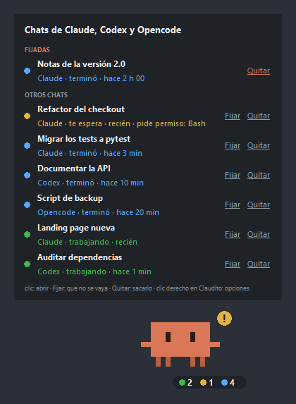
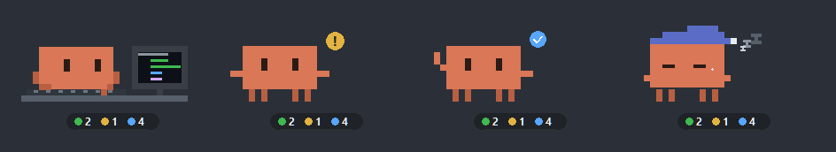

# Claudito

*[Read in English](README.md)*

Una ventanita en la esquina de la pantalla de Windows que muestra en qué está cada chat de **Claude Code**,
**Codex** y **Opencode**: trabajando, esperando tu OK o terminado. Clic en un chat para ir a él.



- Contador y sonido cuando un chat termina o te espera; pasá el mouse para ver la lista.
- Fijá chats para que no se vayan de la lista; quitá los que no te interesan.
- Ícono en la bandeja de Windows con las mismas opciones; siempre al frente.



## Avisos

- **No oficial.** Claudito es un proyecto personal. No lo hace, avala ni mantiene Anthropic, OpenAI ni el equipo de
  Opencode. "Claude", "Codex" y "Opencode" son nombres de sus respectivos dueños. El personaje es pixel art propio y
  no usa dibujos oficiales.
- **Depende de archivos internos no documentados.** Lee archivos internos de la app de escritorio de Claude, de Codex
  y de Opencode. No son APIs públicas: una actualización de cualquiera de esas apps puede romper Claudito sin aviso.
- **Solo lectura sobre las otras apps.** Nunca escribe en los datos de Claude, Codex u Opencode. Solo escribe su
  propia carpeta de estados (`~/.claudito`) y su configuración junto a la app.
- **Todo queda en tu computadora.** Sin red, sin telemetría, sin puertos abiertos.
- **Fragmentos de tus mensajes en disco.** Para nombrar los chats, el hook guarda los primeros ~90 caracteres de tu
  último mensaje en cada chat en `~/.claudito/estado`. Podés borrar esa carpeta cuando quieras; se vuelve a armar.
- **El hook nunca frena nada.** Solo anota el estado: no aprueba, no rechaza ni cambia nada de tu sesión.
- **Solo Windows.** Probado en Windows 11 con Python 3.14.

## Cómo funciona

- `hooks/beacon.py` corre con los hooks de Claude Code (plugin `monitor-chats`) y anota el estado de cada chat en
  `~/.claudito/estado`.
- `app/claudito.pyw` es la ventana (tkinter). Lee esos estados y los títulos de los chats de la app de Claude.
- `app/codex.py` y `app/opencode.py` leen, en **solo lectura**, las bases locales de Codex y de Opencode.
  Codex no deja registro de "esperando aprobación" y Opencode no tiene link por sesión: esos chats muestran menos
  estados, y el clic en uno de Opencode trae la app al frente.

## Instalar (Windows)

1. Python 3 de python.org (con el lanzador `py`).
2. La ventana:

   ```bash
   py -3 instalar.py
   ```

   Instala Pillow y pystray, crea los accesos (Escritorio, menú Inicio, arranque con Windows) y abre Claudito.
3. El hook, como plugin de Claude Code:

   ```bash
   claude plugin marketplace add diegoarusso/claudito
   claude plugin install monitor-chats@claudito
   ```

   Los chats que ya estaban abiertos empiezan a reportar cuando los reiniciás.

## Pruebas

```bash
py -3 -m unittest tests/test_monitor.py tests/test_codex.py tests/test_opencode.py tests/test_ventana.py
```

Las capturas se arman con datos inventados: `py -3 docs/generar_capturas.py`.

## Licencia

[MIT](LICENSE). Las dependencias que instala `instalar.py` (Pillow, pystray) tienen sus propias licencias.
