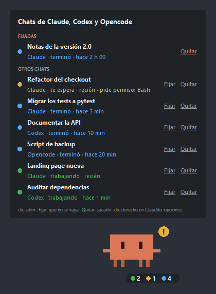
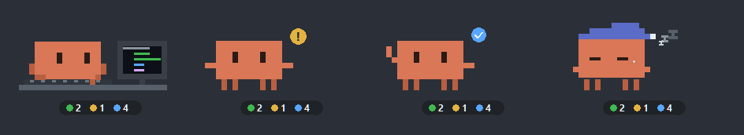

# Claudito

*[Leer en castellano](README.es.md)*

A small window in the corner of your Windows screen that shows what each **Claude Code**, **Codex** and
**Opencode** chat is doing: working, waiting for you, or done. Click a chat to jump to it.



- A counter and a sound when a chat finishes or needs you; hover to see the list.
- Pin chats so they stay on the list; remove the ones you don't care about.
- Tray icon with the same options; always on top.



## Notices

- **Unofficial.** Claudito is a personal project. It is not made, endorsed or supported by Anthropic, OpenAI or the
  Opencode team. "Claude", "Codex" and "Opencode" are names of their respective owners. The character is original
  pixel art and uses no official artwork.
- **Relies on undocumented internals.** It reads internal files of the Claude desktop app, Codex and Opencode. They
  are not public APIs, so an update to any of those apps can break Claudito without notice.
- **Read-only on the other apps.** It never writes to Claude, Codex or Opencode data. The only thing it writes is its
  own state folder (`~/.claudito`) and its settings next to the app.
- **Stays on your computer.** No network access, no telemetry, no open ports.
- **Prompt snippets on disk.** To label chats, the hook saves the first ~90 characters of your last message to each
  chat in `~/.claudito/estado`. Delete that folder at any time; it is rebuilt as you work.
- **The hook never blocks.** It only records state. It never approves, denies or changes anything in your session.
- **Windows only.** Tested on Windows 11 with Python 3.14.

## How it works

- `hooks/beacon.py` runs on Claude Code hooks (the `monitor-chats` plugin) and writes each chat's state to
  `~/.claudito/estado`.
- `app/claudito.pyw` is the window (tkinter). It reads those states plus chat titles from the Claude desktop app.
- `app/codex.py` and `app/opencode.py` read, **read-only**, the local databases of Codex and Opencode.
  Codex has no "waiting for approval" record and Opencode has no per-session link, so those chats show fewer states,
  and clicking an Opencode chat brings the app to the front.

## Install (Windows)

1. Python 3 from python.org (with the `py` launcher).
2. The window:

   ```bash
   py -3 instalar.py
   ```

   It installs Pillow and pystray, creates shortcuts (Desktop, Start menu, start with Windows) and opens Claudito.
3. The hook, as a Claude Code plugin:

   ```bash
   claude plugin marketplace add diegoarusso/claudito
   claude plugin install monitor-chats@claudito
   ```

   Chats that were already open start reporting after you restart them.

## Tests

```bash
py -3 -m unittest tests/test_monitor.py tests/test_codex.py tests/test_opencode.py tests/test_ventana.py
```

The screenshots are made with invented data: `py -3 docs/generar_capturas.py`.

## License

[MIT](LICENSE). Dependencies installed by `instalar.py` (Pillow, pystray) keep their own licenses.
